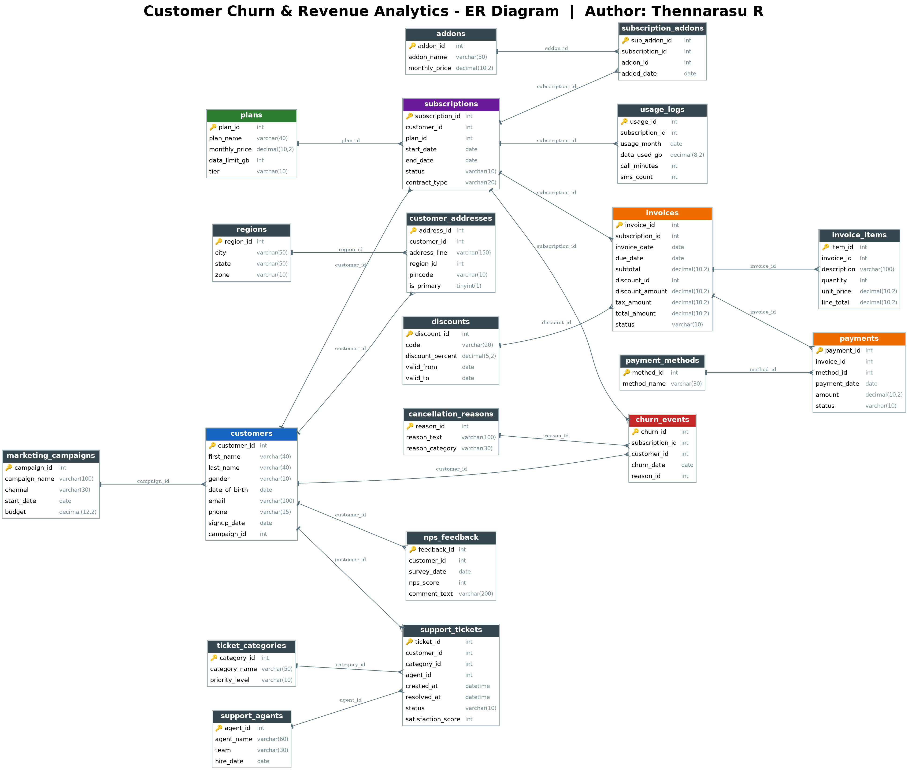

# Customer Churn & Revenue Analytics – SQL Project

## 📌 Project Overview

This is a SQL project I built to understand customer churn in a telecom-style subscription business and see how it affects revenue.

The database has 20 tables covering customers, regions, plans, add-ons, subscriptions, usage, invoices, payments, support tickets, NPS feedback, marketing campaigns and churn events. I also drew an ER diagram to show how the tables are connected.

---

## 🎯 Project Objectives

- Design a database for a subscription business.
- Find out how many customers churn and why.
- Calculate monthly revenue and the revenue lost because of churn.
- Check if support tickets, NPS scores and usage have any link with churn.
- Practice writing SQL queries on a multi-table database.

---

## 🗂️ Database Structure

The project contains the following 20 tables:

| # | Table | Purpose |
|---|---|---|
| 1 | `regions` | City, state and zone details |
| 2 | `marketing_campaigns` | Campaign name, channel, start date and budget |
| 3 | `plans` | Plan name, monthly price, data limit and tier |
| 4 | `addons` | Add-on services and their monthly price |
| 5 | `discounts` | Discount codes, percentage and validity dates |
| 6 | `payment_methods` | Payment method names |
| 7 | `ticket_categories` | Support ticket categories and priority level |
| 8 | `cancellation_reasons` | Reasons for cancellation and their category |
| 9 | `support_agents` | Support agent name, team and hire date |
| 10 | `customers` | Customer personal details and the campaign they came from |
| 11 | `customer_addresses` | Customer addresses linked to regions |
| 12 | `subscriptions` | Customer subscriptions with plan, status and contract type |
| 13 | `subscription_addons` | Add-ons taken under each subscription |
| 14 | `usage_logs` | Monthly data, call and SMS usage |
| 15 | `invoices` | Billing details with subtotal, discount, tax and total |
| 16 | `invoice_items` | Line items inside each invoice |
| 17 | `payments` | Payment amount, date, method and status |
| 18 | `support_tickets` | Tickets raised by customers with satisfaction score |
| 19 | `nps_feedback` | NPS survey scores and comments |
| 20 | `churn_events` | Churn date and reason for each cancelled subscription |

---

## 🔗 Key Relationships

- `marketing_campaigns` → `customers`
- `customers` → `customer_addresses`
- `regions` → `customer_addresses`
- `customers` → `subscriptions`
- `plans` → `subscriptions`
- `subscriptions` → `subscription_addons`
- `addons` → `subscription_addons`
- `subscriptions` → `usage_logs`
- `subscriptions` → `invoices`
- `discounts` → `invoices`
- `invoices` → `invoice_items`
- `invoices` → `payments`
- `payment_methods` → `payments`
- `customers` → `support_tickets`
- `ticket_categories` → `support_tickets`
- `support_agents` → `support_tickets`
- `customers` → `nps_feedback`
- `subscriptions` → `churn_events`
- `customers` → `churn_events`
- `cancellation_reasons` → `churn_events`

The many-to-many relationship between subscriptions and add-ons is handled using the `subscription_addons` table.

---

## 🧩 ER Diagram



---

## 🛠️ Technologies Used

- **Database:** MySQL
- **Query Language:** SQL
- **ER Diagram:** Graphviz / dbdiagram.io
- **Version Control:** Git & GitHub

---

## 📊 Dataset

Each of the 20 tables has 5,000 rows of sample data (100,000 rows in total).

The data is synthetic, generated by me for practice, so it is not real customer data.

---

## 💡 SQL Concepts Practiced

- `SELECT`, `WHERE`, `DISTINCT`, `ORDER BY`
- `GROUP BY` and `HAVING`
- Aggregate functions: `COUNT()`, `SUM()`, `AVG()`, `MIN()`, `MAX()`
- `INNER JOIN`, `LEFT JOIN` and multiple table joins
- Subqueries and CTEs
- Window functions (`RANK`, `ROW_NUMBER`, `LAG`)
- `CASE` statements
- Date-based analysis

---

## 🔍 Example Business Questions

1. What is the overall customer churn rate?
2. What is the monthly churn trend?
3. How much monthly revenue is generated?
4. How much revenue is lost because of churn?
5. Which plan has the highest churn?
6. What are the most common cancellation reasons?
7. Which customers bring the highest revenue?
8. Which regions or zones have the highest churn?
9. Do customers with more support tickets churn more?
10. How do NPS scores differ for churned and active customers?
11. Which marketing campaigns brought customers who stayed longer?
12. How many payments failed and how much money is pending?
13. Does contract type (monthly or yearly) affect churn?
14. Do customers with low data usage churn more?
15. Which add-ons are taken most often?

---

## 📁 Repository Structure

```text
Customer-Churn-Revenue-Analytics/
│
├── README.md
├── 01_create_tables.sql
├── 02_insert_data.sql
├── 03_queries.sql
└── ER_Diagram.png
```

---

## 🚀 How to Run the Project

1. Open MySQL Workbench or MySQL CLI.
2. Run `01_create_tables.sql`. It creates the `project` database and all 20 tables.
3. Run `02_insert_data.sql` to load the sample data.
4. Run `03_queries.sql` to see the analysis.

---

## 📌 Note

All the data here is synthetic and only for learning and portfolio use.

---

## 👨‍💻 Author

**Thennarasu R**

SQL / Data Analytics Project
